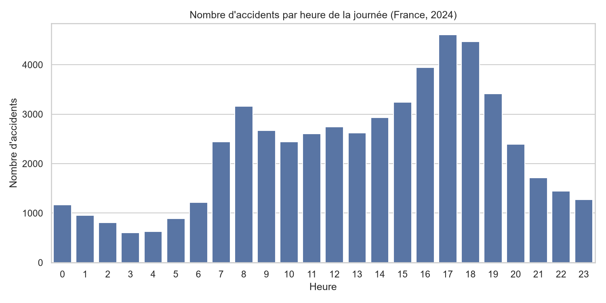
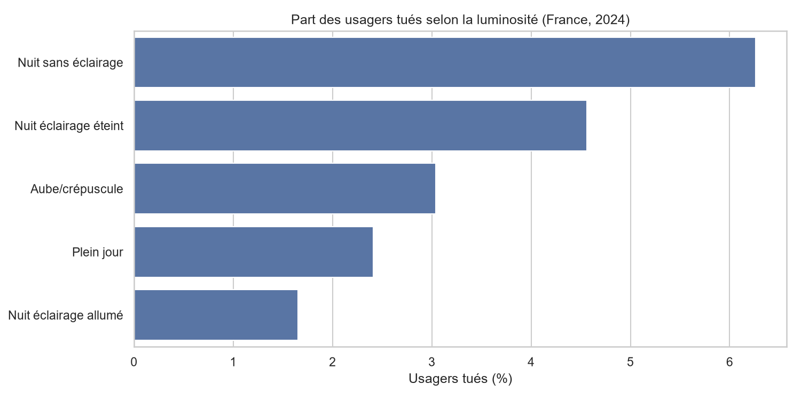
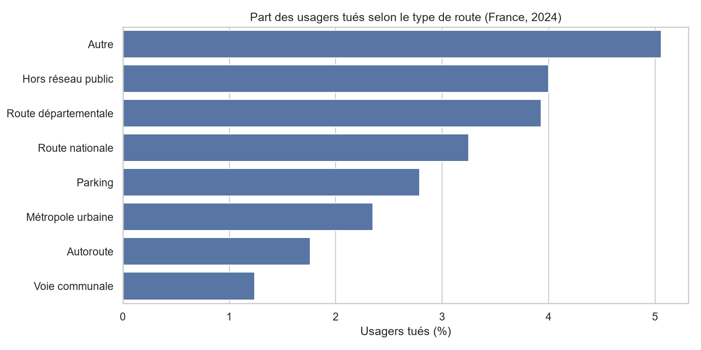

# Analyse des accidents corporels de la route en France (2024)

Projet d'analyse de données : nettoyage, requêtes SQL et visualisations sur les accidents corporels de la circulation routière en France en 2024.

## Objectif
Identifier quand et où les accidents surviennent, et quels facteurs (luminosité, type de route) sont associés aux accidents les plus graves.

## Données
- Source : « Bases de données annuelles des accidents corporels de la circulation routière », data.gouv.fr (Ministère de l'Intérieur / ONISR), année 2024.
- 4 fichiers CSV reliés par la clé `Num_Acc` : caractéristiques, lieux, usagers, véhicules.
- 54 402 accidents et 122 602 usagers après nettoyage.
- Les fichiers CSV ne sont pas inclus dans le dépôt (trop volumineux) : à télécharger sur data.gouv.fr et à placer dans `data/`.

## Méthode
1. **Nettoyage (Python, pandas)** : création des colonnes date, heure et âge, suppression des âges impossibles ou absents (2 585 lignes), remplacement des codes par des libellés lisibles.
2. **Base SQL (SQLite)** : chargement des 4 tables, puis 7 requêtes SQL (jointures, agrégations, `GROUP BY`, `HAVING`), disponibles dans `sql/requetes.sql`.
3. **Visualisation (matplotlib, seaborn)** : 6 graphiques, enregistrés dans `figures/`.

## Résultats





- 16,7 % des accidents ont lieu entre 17h et 19h (pic à 17h).
- La part d'usagers tués est environ 2,6 fois plus élevée la nuit sans éclairage qu'en plein jour.
- La part d'usagers tués est d'environ 3,9 % sur route départementale, contre environ 1,8 % sur autoroute.

Détails et autres graphiques dans le notebook `notebooks/analyse_accidents.ipynb`.

## Limites
Une seule année analysée, corrélations et non causalité, et pas de données de trafic pour mesurer le risque réel.

## Structure du projet
```
├── data/          (CSV à télécharger, base SQLite générée)
├── notebooks/     analyse_accidents.ipynb
├── sql/           requetes.sql
├── figures/       graphiques PNG
└── README.md
```

## Lancer le projet
```bash
pip install pandas matplotlib seaborn jupyter
```
Placer les 4 CSV dans `data/`, puis exécuter toutes les cellules du notebook.